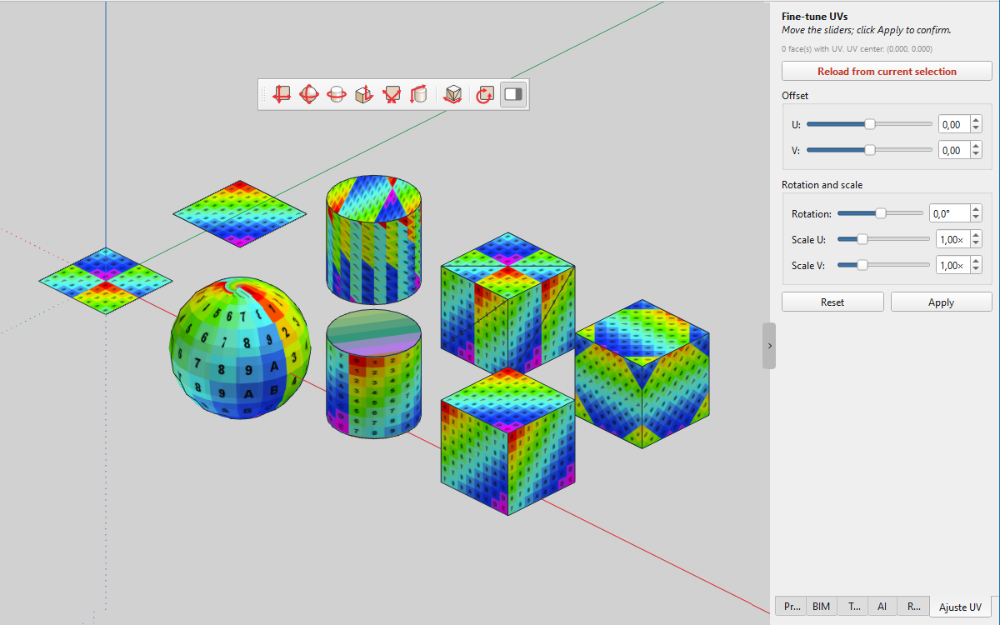

# igz-UV — UV Mapping Tools for IngeTrazo

A UV mapping extension for [IngeTrazo](https://github.com/ingelibre/ingetrazo),
ported from the classic **SketchUV** plugin for SketchUp by
**Dale Martens (Whaat)**.

It brings six projection algorithms, an interactive keyboard-driven
adjuster, a side panel with fine-tuning sliders (U, V, rotation, and
**anisotropic** U/V scaling), and an automatic UV grid for untextured
faces. The user interface is available in English (source), Brazilian
Portuguese, Spanish, and Italian, and can be extended with new
languages without touching Python.



- **Author:** Ezequiel M. Rezende
- **Date:** 2026-10-11
- **Version:** 1.0.0
- **License:** [GPL-3.0-or-later](https://www.gnu.org/licenses/gpl-3.0.html)
  (same as IngeTrazo — see [LICENSE](https://github.com/ingelibre/ingetrazo/blob/main/LICENSE))

---

## Features

### Projection mappings

| Command            | What it does                                                    |
| ------------------ | --------------------------------------------------------------- |
| **Planar Map**     | Projects along the current view direction (SketchUp-style).     |
| **Spherical Map**  | Wraps UVs around a sphere centered on the selection.            |
| **Cylindrical Map**| Wraps UVs around a cylinder aligned to the world Z axis.        |
| **Box Map**        | Assigns each face to its dominant plane (top / side / front).   |
| **Quad Face Map**  | Maps four-vertex faces to the (0,0)–(1,1) square.               |
| **Tube Map**       | Walks the perimeter of an ordered face chain, advancing U.      |

Each command operates on the current selection, one undo step per
invocation.

### Interactive UV Transform (keyboard)

Activate **UV Transform** from the toolbar and use the arrow keys on the
selection:

| Key            | Action            |
| -------------- | ----------------- |
| `←` / `→`      | Move U ±0.05      |
| `↑` / `↓`      | Move V ±0.05      |
| `Shift` + `←`/`→` | Scale U ±5%    |
| `Shift` + `↑`/`↓` | Scale V ±5%    |
| `Ctrl`  + `←`/`→` | Rotate ±1°     |

You can also type a number in the Value Control Box (VCB) and press
Enter: values between −180 and 180 are treated as degrees of rotation,
other positive numbers as a uniform scale factor.

**Note:** the keyboard tool rotates and scales each face around its
own UV origin (0, 0). For a rotation/scale that keeps the selection
coherent, use the fine-tuning panel instead.

### Fine-tuning panel (sliders)

The side panel **Ajuste UV / Adjust UV** provides **five** sliders that
transform the *whole selection at once*, rotating and scaling around the
**common UV center** — this is the key difference from the keyboard
tool, which acts per-face.

- **U** offset, −2.00 to +2.00
- **V** offset, −2.00 to +2.00
- **Rotation** in degrees, −180.0° to +180.0°
- **Scale U** from 0.10× to 4.00× (horizontal stretch)
- **Scale V** from 0.10× to 4.00× (vertical stretch)

The two scale sliders are **independent**, so you can correct textures
with the wrong aspect ratio on elongated or trapezoidal faces without
touching the texture itself. Values are shown live in a spin box next
to each slider.

`Reset` restores the state the panel loaded; `Aplicar / Apply` confirms
and re-snapshots. If the selection changes while the panel is open, the
**Reload selection** button turns **red** to warn you that the panel is
out of sync.

### Triangulate

`Triangulate` splits each selected polygon into a fan of triangles,
reprojecting the UVs so the texture stays identical after the cut.

### Automatic UV grid

Faces without a texture get the built-in `texture_grid.*` from the
plugin's `icons/` folder, so you can see the UV mapping immediately
without painting the face first.

### Internationalization

The interface ships in four languages, following the language of
IngeTrazo itself:

- English (US) — source language
- Brazilian Portuguese
- Spanish
- Italian

Translations live in `i18n/<lang>.json`. At runtime the plugin first
asks `core.i18n.tr` of IngeTrazo; if the host does not have the key
(it usually doesn't, since igz-UV is a third-party extension), the
plugin falls back to its own JSON. Unknown keys return the English
source string, so the plugin never breaks on a missing translation.

### File structure

```
igz-UV/
├── __init__.py            package entry point
├── igz-uv.py              the whole extension
├── icons/                 SVG icons + texture_grid.*
│   ├── texture_grid.jpg
│   ├── uv_planar.svg
│   ├── uv_planar_light.svg
│   └── ...
├── i18n/                  translations, one JSON per language
│   ├── en.json            empty (English is the source)
│   ├── pt-BR.json
│   ├── es.json
│   └── it.json
├── screenshots/           documentation images
│   └── igz-uv.png
├── README.md              this file
├── README_ptBR.md         Portuguese version
├── LICENSE                full GPL-3.0 text
└── THIRD-PARTY.md         third-party notices
```

---

## Install

Copy the `igz-UV` folder into your IngeTrazo user plugin directory:

- **Linux:** `~/.local/share/ingetrazo/plugins/`
- **Windows:** `%APPDATA%\IngeTrazo\plugins\`
- **macOS:** `~/Library/Application Support/IngeTrazo/plugins/`

Or use **Extensions ▸ Open plugins folder** inside IngeTrazo.

Restart IngeTrazo. The **igz-UV** toolbar appears at the top of the
window, and the submenu **Extensions ▸ igz-UV** lists every command
plus the Help entry. The side panel **Adjust UV** is available from
**Window ▸ Panels**.

### Requirements

- IngeTrazo 0.x (API_VERSION 2)
- `texture_grid.*` in the `icons/` folder for the automatic grid
  (optional — the plugin works without it if every face already has a
  texture)

---

## Usage

1. Paint one or more faces with a texture (**Paint → Texture**).
2. Select the faces you want to map.
3. Click a projection button, or open the **Adjust UV** panel and move
   the sliders.
4. Use **UV Transform** on the keyboard for per-face adjustments, or
   the panel for group adjustments.

For the fine-tuning panel:

- The panel takes a **snapshot** of the UVs of the selection when it is
  loaded or when you click **Reload selection**.
- The sliders are **deltas** relative to that snapshot. Sliding back to
  zero restores the original UVs.
- Each slider movement is one undo step. **Reset** returns to the
  snapshot; **Apply** promotes the current state to a new snapshot.

### When to use the panel instead of the keyboard tool

| Situation                                                  | Use              |
| ---------------------------------------------------------- | ---------------- |
| One face, small tweak                                      | Keyboard         |
| Several faces that must stay visually aligned              | Panel            |
| Texture has wrong aspect ratio (needs U ≠ V stretch)       | Panel (Scale U/V)|
| You want to rotate the whole set as one image              | Panel            |
| You want to nudge a single face without touching the rest  | Keyboard         |

---

## How it works (technical notes)

IngeTrazo stores the texture of each face in `face.attrs["texture"]`,
a dict with `{path, sw, sh, rot, uvw}`. The `uvw` entry is an affine
world → UV map:

```
u = gu·p + u0
v = gv·p + v0
```

stored as the flat list `[gu.x, gu.y, gu.z, u0, gv.x, gv.y, gv.z, v0]`.

- Projections compute per-vertex UVs with `core.texture.planar_uv` (or
  our own spherical/cylindrical formulas) and then fit a `uvw` with
  `core.texture.fit_uv_affine`.
- The fine-tuning panel composes **anisotropic scale, rotation, and
  offset** *in UV space* around the common center, then refits the
  `uvw` — that is why the whole selection moves as one image. The scale
  is applied as `diag(su, sv)`, so U and V can stretch independently.
- All mutations go through `core.history.SnapshotImport`, one undo step
  per action.

---

## Translating

Adding a new language does **not** require editing Python. Create a
file in `i18n/` named after the language tag (e.g. `fr.json` for
French, `de.json` for German), and copy the structure of
`i18n/pt-BR.json`:

```json
{
  "_language": "Français",

  "Planar Map": "Carte planaire",
  "Spherical Map": "Carte sphérique",
  "...": "..."
}
```

Rules:

- **Keys are the English source strings**, exactly as they appear in
  `igz-uv.py`. Do not translate the keys.
- **Values are the translation.**
- Keys starting with `_` are metadata and are ignored by the loader
  (`_language`, `_comment`, …).
- Placeholders like `{n}`, `{label}`, `{ok}`, `{total}` must be
  preserved in the translation.
- Each file must be UTF-8 without BOM.

To test, restart IngeTrazo with the interface set to that language;
the plugin picks it up automatically. If the language tag is
`fr-CA` and there is no `fr-CA.json` but there is a `fr.json`,
the plugin uses the `fr` file. If there is no file for the active
language at all, the English source is used — the plugin never
shows a broken key.

To force-reload translations during development without restarting
IngeTrazo, run this in the Python Console:

```python
import sys
for k, m in list(sys.modules.items()):
    if "igz" in k.lower() and "uv" in k.lower() and hasattr(m, "_TEXTS"):
        m._TEXTS.clear()
        print(f"{k}: i18n cache cleared")
        break
```

---

## Credits

- **Original SketchUV (Ruby, SketchUp)** — Dale Martens (Whaat).
- **IngeTrazo** — Marco Sumari Tellez and contributors.
- **Port to IngeTrazo** — Ezequiel M. Rezende.

## License

GPL-3.0-or-later. See
<https://www.gnu.org/licenses/gpl-3.0.html>.