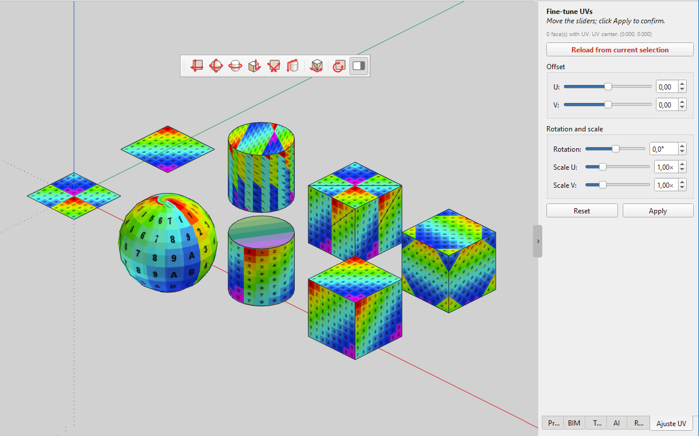

# igz-UV — UV Mapping Tools for IngeTrazo

A UV mapping extension for [IngeTrazo](https://github.com/ingelibre/ingetrazo),
Inspired by classic UV mapping tools, adapted for IngeTrazo.

It brings six projection algorithms, an interactive keyboard-driven
adjuster, a side panel with fine-tuning sliders (U, V, rotation, and
**anisotropic** U/V scaling), and an automatic UV grid for untextured
faces. The user interface is fully internationalized (English source),
and the code is organized into a modular package for better
maintainability.



- **Author:** Ezequiel M. Rezende
- **Date:** 2026-10-14
- **Version:** 1.1.0 (Refactored)
- **License:** [GPL-3.0-or-later](https://www.gnu.org/licenses/gpl-3.0.html)
  (same as IngeTrazo — see [LICENSE](https://github.com/ingelibre/ingetrazo/blob/main/LICENSE))

---

## Features

### Projection mappings

| Command            | What it does                                                    |
| ------------------ | --------------------------------------------------------------- |
| **Planar Map**     | Projects along the current view direction (camera-aligned).     |
| **Spherical Map**  | Wraps UVs around a sphere centered on the selection.            |
| **Cylindrical Map**| Wraps UVs around a cylinder aligned to the world Z axis.        |
| **Box Map**        | Assigns each face to its dominant plane (top / side / front).   |
| **Quad Face Map**  | Maps four-vertex faces to the (0,0)–(1,1) square.               |
| **Tube Map**       | Walks the perimeter of an ordered face chain, advancing U.      |

Each command operates on the current selection, one undo step per
invocation.

### Interactive UV Transform (keyboard)

Activate **UV Transform** from the toolbar and use the arrow keys on the
selection:

| Key            | Action            |
| -------------- | ----------------- |
| `←` / `→`      | Move U ±0.05      |
| `↑` / `↓`      | Move V ±0.05      |
| `Shift` + `←`/`→` | Scale U ±5%    |
| `Shift` + `↑`/`↓` | Scale V ±5%    |
| `Ctrl`  + `←`/`→` | Rotate ±1°     |

You can also type a number in the Value Control Box (VCB) and press
Enter: values between −180 and 180 are treated as degrees of rotation,
other positive numbers as a uniform scale factor.

**Note:** the keyboard tool rotates and scales each face around its
own UV origin (0, 0). For a rotation/scale that keeps the selection
coherent, use the fine-tuning panel instead.

### Fine-tuning panel (sliders)

The side panel **Ajuste UV / Adjust UV** provides **five** sliders that
transform the *whole selection at once*, rotating and scaling around the
**common UV center** — this is the key difference from the keyboard
tool, which acts per-face.

- **U** offset, −2.00 to +2.00
- **V** offset, −2.00 to +2.00
- **Rotation** in degrees, −180.0° to +180.0°
- **Scale U** from 0.10× to 4.00× (horizontal stretch)
- **Scale V** from 0.10× to 4.00× (vertical stretch)

The two scale sliders are **independent**, so you can correct textures
with the wrong aspect ratio on elongated or trapezoidal faces without
touching the texture itself. Values are shown live in a spin box next
to each slider.

`Reset` restores the state the panel loaded; `Aplicar / Apply` confirms
and re-snapshots. If the selection changes while the panel is open, the
**Reload selection** button turns **red** to warn you that the panel is
out of sync.

### Panel Visibility (3-State Button)

The toolbar uses a smart 3-state toggle for the **Adjust UV** button:
1. **Hidden**: Clicking shows the panel and brings it to the front.
2. **Visible but behind other tabs**: Clicking brings it to the front (it does not hide it).
3. **Visible and in front**: Clicking hides it.

The panel uses the host's official API (`app.add_panel`), ensuring it
appears in the "Window ▸ Panels" menu. The icon on the panel's tab is
set using `app._set_panel_icon` with the `uv_panel.svg` icon.

### Triangulate

`Triangulate` splits each selected polygon into a fan of triangles,
reprojecting the UVs so the texture stays identical after the cut.

### Automatic UV grid

Faces without a texture get the built-in `texture_grid.*` from the
plugin's `icons/` folder, so you can see the UV mapping immediately
without painting the face first.

### Internationalization

The interface ships with seven languages, following the language of
IngeTrazo itself. It checks the `i18n/<lang>.json` files, falling back
to English if no specific match is found:

- English (US) — source language
- Brazilian Portuguese (pt-BR)
- Spanish (es)
- German (de)
- French (fr)
- Italian (it)
- Chinese (zh)

To add a new language, simply create a new `.json` file (e.g.,
`ru.json`) in the `i18n/` folder by copying the structure of
`pt-BR.json`. No Python code changes are required.

### File structure

The extension is now organized as a Python package:

```text
igz-uv/
├── __init__.py            # Package entry point and i18n logic
├── core/                  # Modular source code
│   ├── __init__.py
│   ├── math_utils.py      # Pure geometry (vectors, cross, length, etc.)
│   ├── texture.py         # Face UV model (get/set uvw, grid texture)
│   ├── transforms.py      # Affine transform composition
│   ├── mappings.py        # Planar/Spherical/Cylindrical/Box/Quad/Tube
│   ├── triangulate.py     # Triangulation preserving UVs
│   ├── keyboard_tool.py   # UVTransformTool (keyboard interaction)
│   ├── panel.py           # UVAdjustPanel (QWidget with sliders)
│   └── toolbar.py         # Toolbar, menu, and panel attachment
├── icons/                 # SVG icons + texture_grid.*
│   ├── texture_grid.jpg
│   ├── uv_planar.svg
│   ├── uv_planar_light.svg
│   ├── uv_panel.svg
│   └── ...
├── i18n/                  # Translations, one JSON per language
│   ├── en.json            # Empty (English is the source)
│   ├── pt-BR.json
│   ├── es.json
│   ├── de.json
│   ├── fr.json
│   ├── it.json
│   └── zh.json
├── README.md              # This file
├── README_ptBR.md         # Portuguese version
├── LICENSE                # Full GPL-3.0 text
└── THIRD-PARTY.md         # Third-party notices
```

The repository also holds the tooling and the documentation images, which
are **not** part of the package: `packaging/` (the `.zip` builders and the
release notes), `dist/` (the generated artifact), `screenshots/` and
`ingetrazo-extensions-submission/` (the catalog entry).

---

## Install

Copy the `igz-uv` folder into your IngeTrazo user plugin directory:

- **Linux:** `~/.local/share/ingetrazo/plugins/`
- **Windows:** `%APPDATA%\IngeTrazo\plugins\`
- **macOS:** `~/Library/Application Support/IngeTrazo/plugins/`

Or use **Extensions ▸ Open plugins folder** inside IngeTrazo.

Restart IngeTrazo. The **igz-UV** toolbar appears at the top of the
window, and the submenu **Extensions ▸ igz-UV** lists every command
plus the Help entry. The side panel **Adjust UV** is available from
**Window ▸ Panels**.

### Requirements

- IngeTrazo 0.5.7+ (API supports `app.add_panel`).
- `texture_grid.*` in the `icons/` folder for the automatic grid
  (optional — the plugin works without it if every face already has a
  texture)

---

## Usage

1. Paint one or more faces with a texture (**Paint → Texture**).
2. Select the faces you want to map.
3. Click a projection button, or open the **Adjust UV** panel and move
   the sliders.
4. Use **UV Transform** on the keyboard for per-face adjustments, or
   the panel for group adjustments.

For the fine-tuning panel:

- The panel takes a **snapshot** of the UVs of the selection when it is
  loaded or when you click **Reload selection**.
- The sliders are **deltas** relative to that snapshot. Sliding back to
  zero restores the original UVs.
- Each slider movement is one undo step. **Reset** returns to the
  snapshot; **Apply** promotes the current state to a new snapshot.

### When to use the panel instead of the keyboard tool

| Situation                                                  | Use              |
| ---------------------------------------------------------- | ---------------- |
| One face, small tweak                                      | Keyboard         |
| Several faces that must stay visually aligned              | Panel            |
| Texture has wrong aspect ratio (needs U ≠ V stretch)       | Panel (Scale U/V)|
| You want to rotate the whole set as one image              | Panel            |
| You want to nudge a single face without touching the rest  | Keyboard         |

---

## How it works (technical notes)

IngeTrazo stores the texture of each face in `face.attrs["texture"]`,
a dict with `{path, sw, sh, rot, uvw}`. The `uvw` entry is an affine
world → UV map:

```
u = gu·p + u0
v = gv·p + v0
```

stored as the flat list `[gu.x, gu.y, gu.z, u0, gv.x, gv.y, gv.z, v0]`.

- Projections compute per-vertex UVs with `core.texture.planar_uv` (or
  our own spherical/cylindrical formulas) and then fit a `uvw` with
  `core.texture.fit_uv_affine`.
- The fine-tuning panel composes **anisotropic scale, rotation, and
  offset** *in UV space* around the common center, then refits the
  `uvw` — that is why the whole selection moves as one image. The scale
  is applied as `diag(su, sv)`, so U and V can stretch independently.
- All mutations go through `core.history.SnapshotImport`, one undo step
  per action.

---

## Translating

Adding a new language does **not** require editing Python. Create a
file in `i18n/` named after the language tag (e.g. `ru.json` for
Russian), and copy the structure of `i18n/pt-BR.json`:

```json
{
  "_language": "Русский",

  "Planar Map": "Плоская карта",
  "Spherical Map": "Сферическая карта",
  "...": "..."
}
```

Rules:

- **Keys are the English source strings**, exactly as they appear in the
  `core/*.py` files. Do not translate the keys.
- **Values are the translation.**
- Keys starting with `_` are metadata and are ignored by the loader
  (`_language`, `_comment`, …).
- Placeholders like `{n}`, `{label}`, `{ok}`, `{total}` must be
  preserved in the translation.
- Each file must be UTF-8 without BOM.

To test, restart IngeTrazo with the interface set to that language;
the plugin picks it up automatically.

---

## Credits

- **Inspired by classic UV mapping tools**, adapted for IngeTrazo.
- **IngeTrazo** — Marco Sumari Tellez and contributors.
- **Adapted for IngeTrazo** — Ezequiel M. Rezende.

## License

GPL-3.0-or-later. See
<https://www.gnu.org/licenses/gpl-3.0.html>.
