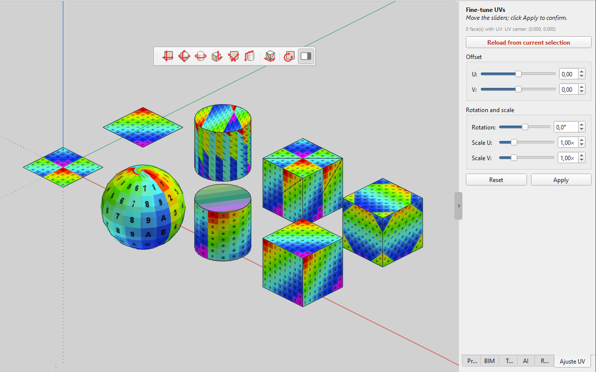

# igz-UV — Ferramentas de Mapeamento UV para o IngeTrazo

Extensão de mapeamento UV para o
[IngeTrazo](https://github.com/ingelibre/ingetrazo), inspirada em ferramentas
clássicas de mapeamento UV, adaptada para o IngeTrazo.

Traz seis algoritmos de projeção, um ajustador interativo por teclado,
um painel lateral com sliders de ajuste fino (U, V, rotação e **escala
anisotrópica** U/V) e uma grade UV automática para faces sem textura. A
interface é totalmente internacionalizada (a fonte é o inglês) e o código
está organizado como um pacote modular para facilitar a manutenção.



- **Autor:** Ezequiel M. Rezende
- **Data:** 2026-10-14
- **Versão:** 1.1.0 (Refatorada)
- **Licença:** [GPL-3.0-or-later](https://www.gnu.org/licenses/gpl-3.0.html)
  (mesma do IngeTrazo — ver [LICENSE](https://github.com/ingelibre/ingetrazo/blob/main/LICENSE))

---

## Recursos

### Mapeamentos

| Comando            | O que faz                                                       |
| ------------------ | --------------------------------------------------------------- |
| **Planar Map**     | Projeta pela direção da vista atual (alinhado à vista).          |
| **Spherical Map**  | Envolve as UVs numa esfera centrada na seleção.                 |
| **Cylindrical Map**| Envolve as UVs num cilindro alinhado ao eixo Z do mundo.        |
| **Box Map**        | Atribui cada face ao plano dominante (topo / lateral / frente). |
| **Quad Face Map**  | Mapeia faces de quatro lados no quadrado (0,0)–(1,1).           |
| **Tube Map**       | Percorre o perímetro de uma cadeia ordenada de faces.           |

Cada comando age sobre a seleção atual, em um único passo de undo.

### UV Transform interativo (teclado)

Ative **UV Transform** na toolbar e use as setas com a seleção ativa:

| Tecla             | Ação              |
| ----------------- | ----------------- |
| `←` / `→`         | Move U ±0.05      |
| `↑` / `↓`         | Move V ±0.05      |
| `Shift` + `←`/`→` | Escala U ±5%      |
| `Shift` + `↑`/`↓` | Escala V ±5%      |
| `Ctrl`  + `←`/`→` | Rotaciona ±1°     |

Também é possível digitar um número no VCB e pressionar Enter: valores
entre −180 e 180 são tratados como graus de rotação; outros valores
positivos, como fator de escala uniforme.

**Atenção:** a ferramenta de teclado gira e escala cada face em torno do
seu próprio (0, 0) de UV. Para girar/escalar a seleção de forma **coesa**
(como uma imagem única), use o painel de ajuste fino.

### Painel de ajuste fino (sliders)

O painel lateral **Ajuste UV** traz **cinco** sliders que transformam
**toda a seleção de uma vez**, girando e escalando em torno do **centro
UV comum** — é a diferença central em relação à ferramenta de teclado,
que age face por face.

- Deslocamento **U**, −2.00 a +2.00
- Deslocamento **V**, −2.00 a +2.00
- **Rotação** em graus, −180,0° a +180,0°
- **Escala U** de 0,10× a 4,00× (esticar horizontal)
- **Escala V** de 0,10× a 4,00× (esticar vertical)

Os dois sliders de escala são **independentes**: dá para corrigir a
proporção de uma textura em faces alongadas ou trapezoidais sem mexer na
textura em si. Os valores aparecem em tempo real numa caixa numérica ao
lado de cada slider.

**Reset** volta ao estado carregado pelo painel; **Aplicar** confirma e
tira novo snapshot. Se a seleção mudar com o painel aberto, o botão
**Recarregar da seleção atual** fica **vermelho** para avisar que o
painel está fora de sincronia.

### Visibilidade do Painel (Botão de 3 Estados)

A toolbar usa um toggle inteligente de 3 estados para o botão **Ajustar UV**:
1. **Escondido**: Clicar mostra o painel e o traz para frente.
2. **Visível, mas atrás de outras abas**: Clicar traz o painel para frente (não o esconde).
3. **Visível e na frente**: Clicar esconde o painel.

O painel usa a API oficial do hospedeiro (`app.add_panel`), garantindo que
ele apareça corretamente no menu "Janela ▸ Painéis" do IngeTrazo. O ícone
na aba do painel é definido usando `app._set_panel_icon` com o ícone
`uv_panel.svg`.

### Triangulate

`Triangulate` divide cada polígono selecionado num leque de triângulos,
reprojetando as UVs para que a textura permaneça idêntica após o corte.

### Grade UV automática

Faces sem textura recebem a `texture_grid.*` da pasta `icons/` do
plugin, para você ver o mapeamento imediatamente sem precisar pintar a
face antes.

### Internacionalização

A interface está disponível em **sete** idiomas, acompanhando o idioma
do IngeTrazo. O plugin verifica os arquivos `i18n/<lang>.json`,
caindo para o inglês caso não encontre correspondência:

- Inglês (EUA) — idioma-fonte
- Português do Brasil (pt-BR)
- Espanhol (es)
- Alemão (de)
- Francês (fr)
- Italiano (it)
- Chinês (zh)

Para adicionar um novo idioma, não é necessário alterar o Python. Basta
criar um novo arquivo `.json` (ex.: `ru.json`) na pasta `i18n/`,
copiando a estrutura do `pt-BR.json`.

### Estrutura de arquivos

A extensão agora está organizada como um pacote Python:

```text
igz-uv/
├── __init__.py            # Ponto de entrada e lógica de i18n
├── core/                  # Código-fonte modular
│   ├── __init__.py
│   ├── math_utils.py      # Geometria pura (vetores, cross, length, etc.)
│   ├── texture.py         # Modelo UV da face (get/set uvw, textura)
│   ├── transforms.py      # Composição de transformações afins
│   ├── mappings.py        # Planar/Esférico/Cilíndrico/Box/Quad/Tubo
│   ├── triangulate.py     # Triangulação preservando UVs
│   ├── keyboard_tool.py   # UVTransformTool (interação por teclado)
│   ├── panel.py           # UVAdjustPanel (QWidget com sliders)
│   └── toolbar.py         # Toolbar, menu e anexo do painel
├── icons/                 # Ícones SVG + texture_grid.*
│   ├── texture_grid.jpg
│   ├── uv_planar.svg
│   ├── uv_planar_light.svg
│   ├── uv_panel.svg
│   └── ...
├── i18n/                  # Traduções, um JSON por idioma
│   ├── en.json            # Vazio (o inglês é a fonte)
│   ├── pt-BR.json
│   ├── es.json
│   ├── de.json
│   ├── fr.json
│   ├── it.json
│   └── zh.json
├── README.md              # Versão em inglês
├── README_ptBR.md         # Este arquivo
├── LICENSE                # Texto completo da GPL-3.0
└── THIRD-PARTY.md         # Avisos de terceiros
```

O repositório também contém as ferramentas e as imagens de documentação,
que **não** fazem parte do pacote: `packaging/` (os geradores do `.zip` e as
notas de versão), `dist/` (o artefato gerado), `screenshots/` e
`ingetrazo-extensions-submission/` (a ficha do catálogo).

---

## Instalação

Copie a pasta `igz-uv` para o diretório de plugins do usuário:

- **Linux:** `~/.local/share/ingetrazo/plugins/`
- **Windows:** `%APPDATA%\IngeTrazo\plugins\`
- **macOS:** `~/Library/Application Support/IngeTrazo/plugins/`

Ou use **Extensions ▸ Open plugins folder** dentro do IngeTrazo.

Reinicie o IngeTrazo. A toolbar **igz-UV** aparece no topo da janela, e
o submenu **Extensions ▸ igz-UV** lista todos os comandos mais a
entrada de Ajuda. O painel lateral **Ajuste UV** fica disponível em
**Window ▸ Panels**.

### Requisitos

- IngeTrazo 0.5.7+ (API com suporte a `app.add_panel`).
- `texture_grid.*` na pasta `icons/` para a grade automática
  (opcional — o plugin funciona sem ela se todas as faces já tiverem
  textura)

---

## Como usar

1. Pinte uma ou mais faces com uma textura (**Paint → Texture**).
2. Selecione as faces que quer mapear.
3. Clique num botão de projeção, ou abra o painel **Ajuste UV** e mova
   os sliders.
4. Use **UV Transform** no teclado para ajustes face a face, ou o painel
   para ajustes em bloco.

Para o painel de ajuste fino:

- O painel tira um **snapshot** das UVs da seleção quando é carregado ou
  quando você clica em **Recarregar da seleção atual**.
- Os sliders são **deltas** relativos a esse snapshot. Voltar tudo a
  zero restaura as UVs originais.
- Cada movimento de slider é um passo de undo. **Reset** volta ao
  snapshot; **Aplicar** promove o estado atual a novo snapshot.

### Quando usar o painel em vez do teclado

| Situação                                                     | Ferramenta       |
| ------------------------------------------------------------ | ---------------- |
| Uma face, ajuste pequeno                                     | Teclado          |
| Várias faces que devem ficar visualmente alinhadas           | Painel           |
| Textura com proporção errada (precisa esticar U ≠ V)         | Painel (Escala U/V) |
| Você quer girar o conjunto inteiro como uma imagem única     | Painel           |
| Você quer mexer só numa face sem afetar as outras            | Teclado          |

---

## Como funciona (notas técnicas)

O IngeTrazo guarda a textura de cada face em `face.attrs["texture"]`, um
dict com `{path, sw, sh, rot, uvw}`. O campo `uvw` é um mapa afim
world → UV:

```
u = gu·p + u0
v = gv·p + v0
```

armazenado como a lista plana `[gu.x, gu.y, gu.z, u0, gv.x, gv.y, gv.z, v0]`.

- As projeções calculam UVs por vértice com `core.texture.planar_uv` (ou
  nossas fórmulas próprias de esfera/cilindro) e em seguida encaixam um
  `uvw` com `core.texture.fit_uv_affine`.
- O painel de ajuste fino compõe **escala anisotrópica, rotação e
  deslocamento** no espaço UV em torno do centro comum, depois reencaixa
  o `uvw` — é por isso que a seleção inteira se move como uma imagem
  única. A escala entra como `diag(su, sv)`, permitindo esticar U e V
  independentemente.
- Todas as mutações passam por `core.history.SnapshotImport`, um passo
  de undo por ação.

---

## Traduzindo

Adicionar um idioma novo **não** exige editar Python. Crie um
arquivo em `i18n/` com o nome do idioma (ex.: `ru.json` para
russo), copiando a estrutura de `i18n/pt-BR.json`:

```json
{
  "_language": "Русский",

  "Planar Map": "Плоская карта",
  "Spherical Map": "Сферическая карта",
  "...": "..."
}
```

Regras:

- **As chaves são as strings-fonte em inglês**, exatamente como
  aparecem nos arquivos `core/*.py`. Não traduza as chaves.
- **Os valores são a tradução.**
- Chaves começando com `_` são metadados e o carregador as ignora
  (`_language`, `_comment`, ...).
- Placeholders como `{n}`, `{label}`, `{ok}`, `{total}` devem ser
  preservados na tradução.
- Cada arquivo deve estar em UTF-8 sem BOM.

Para testar, reinicie o IngeTrazo com a interface nesse idioma; o
plugin pega automaticamente.

---

## Créditos

- **Inspirada em ferramentas clássicas de mapeamento UV** — adaptada para o IngeTrazo.
- **IngeTrazo** — Marco Sumari Tellez e colaboradores.
- **Adaptada para o IngeTrazo** — Ezequiel M. Rezende.

## Licença

GPL-3.0-or-later. Ver
<https://www.gnu.org/licenses/gpl-3.0.html>.
